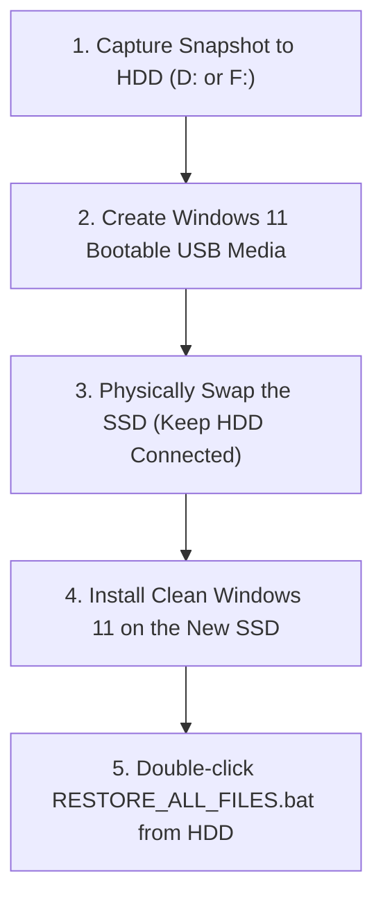

# ⚡ SnapShift Studio — SSD Upgrade & Workspace Migration Suite

> **Autonomous System Snapshot & Zero-Dependency Restoration Suite for Hardware Storage Upgrades**

---

## 🎯 What This System Does

When replacing the primary **M.2 / SATA SSD** holding your Windows operating system on a computer with **only one SSD slot**, traditional cloning tools often fail or require external USB enclosure hardware.

**SnapShift Studio** solves this seamlessly by leveraging your internal **Western Digital 1TB HDD** (`D:` & `F:`):
1. Captures a complete snapshot of all **personal workspace folders**, **developer configs**, **browser bookmarks**, **editor settings**, and **system PATH environment variables** onto the safe internal HDD.
2. Catalogs all **installed software applications** (Winget packages + VS Code extensions) into an automated batch reinstaller script.
3. Automatically embeds **Zero-Dependency Native Restoration Tools** (`RESTORE_ALL_FILES.bat`, `RESTORE_INTERACTIVE.ps1`, `RESTORE_VIEWER.html`) inside every snapshot.
4. When you install fresh Windows on the new SSD, you simply open your HDD and double-click `RESTORE_ALL_FILES.bat` — **no Node.js or Python installation required!**

---

## 🖥️ Detected Hardware Topology

| Component | Device / Volume | Status / Role | Free Space / Capacity |
| :--- | :--- | :--- | :--- |
| **Source SSD** | **PNY CS2040 128GB SSD** (`C:`) | ⚠️ **Drive to Replace** | 15.46 GB Free / 119 GB Total |
| **Safe Storage** | **WDC 1TB SATA HDD** (`D: GameZone`) | 🛡️ **Recommended Backup Target** | **193.41 GB Free** / 300 GB Total |
| **Safe Storage** | **WDC 1TB SATA HDD** (`F: Entertainment`) | 🛡️ **Secondary Safe Target** | **79.26 GB Free** / 331 GB Total |

---

## 🚀 How to Run the Application

### Option A: Modern Glassmorphic Web Dashboard (Recommended)
Double-click:
```bat
START_WEB_STUDIO.bat
```
Or start manually via terminal:
```bash
node server.js
```
Then open: **`http://127.0.0.1:4242`**

### Option B: Terminal CLI Interface
Double-click:
```bat
START_TERMINAL_CLI.bat
```
Or start manually via terminal:
```bash
node cli.js
```
Command-line options:
- `node cli.js --scan-only` : Runs hardware topology and storage scan only.
- `node cli.js --auto-snapshot` : Creates an automated snapshot directly to `D:\SnapShift_Snapshots`.

---

## 🧭 The 5-Step SSD Replacement Roadmap



### Phase 1: Capture Snapshot (Before Removing SSD)
1. Launch `START_WEB_STUDIO.bat` or `START_TERMINAL_CLI.bat`.
2. Confirm destination drive is set to **`D:`** (or **`F:`**).
3. Click **"Create System Snapshot"** (or choose Option `1` in the CLI).
4. All selected personal files, configurations, and scripts will be written to `D:\SnapShift_Snapshots\Snapshot_<Timestamp>\`.

### Phase 2: Create Windows 11 Installation USB
1. Insert a spare USB flash drive (8GB+).
2. Download Microsoft's official [Windows 11 Media Creation Tool](https://www.microsoft.com/software-download/windows11).
3. Follow the Microsoft wizard to create bootable installation media.

### Phase 3: Physically Swap the SSD
1. Shut down the computer completely and unplug the power cable.
2. Remove the old **PNY 128GB SSD** from the motherboard slot.
3. Install your **new SSD** into the slot and secure it.
4. **CRITICAL:** Keep your Western Digital 1TB HDD connected! It holds all your backup data safely.

### Phase 4: Clean Install Windows on the New SSD
1. Plug in your Windows 11 bootable USB and turn on the PC.
2. Boot into the Windows installer and select the **new SSD** as the target.
3. Complete initial setup (language, username, password).

### Phase 5: Restore Everything from the HDD
1. Open Windows File Explorer and navigate to your HDD:
   ```
   D:\SnapShift_Snapshots\<Latest_Snapshot>\
   ```
2. Double-click **`RESTORE_ALL_FILES.bat`**.
3. Press `Y` to confirm. It will automatically:
   - Restore your **Desktop, Documents, Pictures, Videos, Music, Downloads** via multi-threaded Robocopy (`/E /XJ /MT:8`).
   - Restore your **SSH keys (.ssh)**, **Git config (.gitconfig)**, **VS Code extensions**, **Gemini**, and **Antigravity** profiles.
   - Restore **VS Code settings**, **Chrome bookmarks**, **Edge bookmarks**, and **Windows Terminal profiles**.
   - Restore your custom **User Environment Variables (PATH)**.
   - Prompt you to auto-reinstall all **54 applications** via Windows Winget!

---

## 📦 What Is Preserved

- **Personal Data (~16.6 GB):** Desktop, Documents, Downloads, Pictures, Videos, Music.
- **Developer Environments (~6.0 GB):** `~/.ssh`, `~/.gitconfig`, `~/.vscode`, `~/.codex`, `~/.copilot`, `~/.npmrc`, `~/.wslconfig`, `~/.gemini`, `~/.antigravity-ide`.
- **Application Settings:** VS Code `settings.json`, snippets & keybindings, Google Chrome Bookmarks, Microsoft Edge Bookmarks, Windows Terminal profiles.
- **Environment Variables:** User PATH and custom registry environment keys.
- **54 Software Packages:** Automated 1-click Winget bulk installer script.

---

## 🛠️ Project Structure

```
f:\PhotoFix\
├── START_WEB_STUDIO.bat         # 1-Click launcher for Web UI
├── START_TERMINAL_CLI.bat       # 1-Click launcher for Terminal CLI
├── server.js                    # High-performance HTTP & SSE streaming server
├── cli.js                       # Interactive terminal migration interface
├── README.md                    # System documentation and migration roadmap
├── package.json                 # Project configuration
├── lib/
│   ├── scanner.js               # Hardware, disk topology, and workspace scanner
│   ├── snapshotEngine.js        # Snapshot creation engine & zero-dependency tool generator
│   └── restoreEngine.js         # Restoration engine & snapshot discovery
└── public/
    ├── index.html               # Glassmorphic web dashboard
    ├── app.js                   # Reactive frontend logic & SSE stream handler
    └── style.css                # Premium modern design system tokens & animations
```

---

*SnapShift Studio — Built for safe, effortless SSD migrations without OS bloat.*
